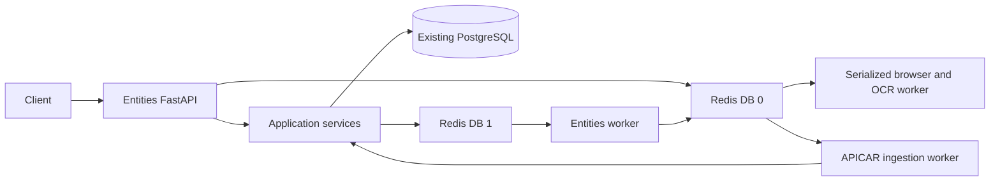

# Cars & Beyond backend

Backend for vehicle auction ingestion and enrichment, bidding, inventory, user management and analytics.

The application now lives in **entities/**. The former **parsers** FastAPI application, package and Dockerfile have been removed; its active integrations, jobs, API contracts, tests and reference fixtures are part of entities.

## Runtime architecture



One API/codebase, with separate worker processes for different workloads:

| Compose service | Application / queue | Responsibility |
| --- | --- | --- |
| `entities` | `main:app` | Existing business APIs and transferred parsing routes |
| `celery` | `core.celery_config.app`, `car_parsing_queue` | Existing vehicle background workflows |
| `celery_worker` | `core.integration_celery.app`, `celery`, solo | Periodic APICAR import/deletion |
| `scraping_worker` | `core.integration_celery.app`, `scraping`, solo | DealerCenter, browser-based fees and OCR |
| `celery_beat_entities` | Redis DB 1, America/Chicago | Existing entities schedules |
| `celery_beat` | Redis DB 0, UTC | Existing APICAR schedules |

The two Redis databases and legacy task names are retained so messages already queued before migration remain routable. The scraping worker processes one operation at a time and reuses its asyncio event loop and authentication state. Keep one active scraping worker while auth synchronization remains process-local.

## Code boundaries

```text
entities/
  api/v1/routers/       HTTP contracts and error mapping
  services/            Application scenarios and import planning
  domain/              Pure calculations and internal data/port definitions
  crud/                SQLAlchemy persistence operations
  integrations/
    apicar/            APICAR client and data conversion
    dealercenter/      Production/local scraper implementations
    fees/              Copart and IAAI extraction
    parsing.py         Local compatibility adapter for existing callers
    scraping_rpc.py    Dedicated scraping queue adapter
  tasks/               Celery entrypoints and legacy task aliases
  models/              Existing ORM/database mappings
  schemas/             Public request/response models
  tests/               Unit, HTTP, PostgreSQL and runtime checks
```

APICAR import calls the bulk application service directly. No internal HTTP calls to a parsers server remain. The temporary `ParsingClient` compatibility boundary retains HTTPX-style responses for legacy error handling; its legacy hostname is response metadata only.

Manual vehicle upsert uses `services/vehicle_upsert.py` to commit persistence before publishing enrichment through an injected queue adapter. Its parsing decision is a pure domain rule. Broker failure preserves the saved vehicle and the existing successful response with a null task id.

Single-VIN lookup uses the injected `VehicleDataSource` interface and `services/single_vehicle_ingestion.py`. The APICAR adapter returns validated snapshots; the router maps application errors to the existing HTTP responses. Legacy error text is retained in the adapter.

`services/vehicle_snapshot.py` owns the transaction for snapshot persistence. `crud/vehicle_snapshot.py` writes the vehicle, photos, conditions and sales history without committing. Its application result distinguishes a failed save from a successful save that needs no enrichment; existing endpoint response policies are retained.

Recommendation decisions for bulk imports, individual snapshots and manual upserts live in `domain/vehicle_recommendations.py`. They use immutable facts/state and retain each workflow's current fuel normalization, bid limit, manual override and reason formatting rules. `services/vehicle_recommendations.py` maps ORM/schema values to these domain inputs and applies the resulting state.

`tasks.task.update_car_bids` delegates to `services/vehicle_bids.py`, which owns the refresh transaction. `crud/vehicle_bids.py` selects candidates and locks matching rows with `SKIP LOCKED`; domain functions handle bid identities, recommendation changes and profit/ROI calculations. The injected current-bid source retains the existing parser request, retry policy and payload handling.

`tasks.task.update_fees` delegates Copart tariff replacement to `services/fee_import.py`. The source adapter preserves the existing scraping call; `domain/fee_import.py` converts ranges, percentages and fixed fees, and `crud/fee_import.py` replaces exact `copart` rows inside the service transaction. Conversion or commit failure rolls back the replacement. A valid empty table retains the previous behavior of clearing Copart tariffs.

IAAI upload uses an injected image source, its separate conversion policy in `domain/iaai_fees.py`, and the same service/CRUD boundaries for async persistence. The router retains multipart inputs, forwarded response/status and 502/500 error mapping. Its legacy JSON error response policy is preserved: upstream 400/500 JSON may still replace IAAI tariffs with default fees before that status is forwarded.

Scheduled filter dispatch delegates to `services/filter_kickoff_queue.py`. Its sync repository acquires the existing advisory transaction lock and selects due scheduled jobs with `SKIP LOCKED`; an injected publisher retains the kickoff task name, queue and kwargs. Publication still precedes commit, so a commit failure can leave an already published job scheduled for a later retry. The kickoff execution task remains a separate legacy scenario.

Database engines are created lazily through `db/factories.py`, using the shared `DatabaseConfig`. API and async jobs use `session_scope`: outstanding transactions are rolled back and sessions are closed, while application services retain ownership of commit. API shutdown and the integration worker's event-loop shutdown release their async pools. Sync workers own a separate lazy pool and discard inherited pools after fork without closing parent connections.

Pool defaults remain 50 connections plus 10 overflow per process, a 30-second acquisition timeout and 1800-second recycle. Configure `DB_POOL_SIZE`, `DB_MAX_OVERFLOW`, `DB_POOL_TIMEOUT` and `DB_POOL_RECYCLE` in the environment. SQL echo defaults to off (`DB_ECHO_SQL=false`); statement parameters are hidden. Alembic uses the shared URL builder and resolves revision paths relative to `alembic.ini`.

Browser/OCR libraries are loaded by their adapters in the scraping worker. Importing the API does not import Playwright, BeautifulSoup, Pillow or Tesseract.

## API compatibility

Existing entities paths and request/response schemas are unchanged. The former parser routes are now served by the same API:

- `GET /api/v1/apicar/get/{car_vin}`
- `GET /api/v1/apicar/update/{car_vin}`
- `GET /api/v1/parsers/scrape/dc`
- `POST /api/v1/parsers/scrape/current_bid`
- `GET /api/v1/parsers/scrape/fees`
- `POST /api/v1/parsers/scrape/iaai/fees`
- `POST /startup`

Compose maps host ports **8000 and 8001 to the same API port 8000**. External clients using the old host port can retain their paths. There is no separate Docker service/DNS name `parsers`; internal integrations use local services or queues.

OpenAPI snapshots verify the transferred operations, including parameter names and legacy spelling. The existing `/api/v1/apicar/{vin}` path remains absent; correcting callers that used that missing path is a separate behavior change.

## Environment and deployment

Use Python **3.12** for the verified development environment. Configuration is centralized in `entities/.env`; [entities/.env.example](entities/.env.example) documents the names without real credentials. Keep existing database settings and secrets when migrating.

Key integration settings:

| Variable | Purpose |
| --- | --- |
| `APICAR_KEY` | APICAR credential, formerly configured in parsers |
| `DC_USERNAME`, `DC_PASSWORD` | DealerCenter login |
| `DC_SMTP_USER`, `DC_SMTP_PASSWORD` | MFA inbox; falls back to existing SMTP credentials |
| `PARSING_ENVIRON` | `prod` by default; `dev` selects the former local scraper |
| `ENTITIES_BROKER_URL`, `ENTITIES_RESULT_BACKEND` | Default `redis://redis:6379/1` |
| `INTEGRATION_BROKER_URL`, `INTEGRATION_RESULT_BACKEND` | Default `redis://redis:6379/0` |
| `DEALERCENTER_CREDENTIALS_FILE` | Local scraper cache; scraping image uses its persistent volume |

The two Celery applications use explicit scoped settings; generic `CELERY_BROKER_URL` / `CELERY_RESULT_BACKEND` cannot override both applications in the same process.

Compose temporarily reads an optional existing `parsers/.env` for migration. It does not modify that file. Entities settings take precedence for the API and ingestion; legacy parser settings take precedence inside the scraping worker. Consolidate those credentials into entities configuration and set `PARSING_ENVIRON` to the former parser `ENVIRON` value before removing the optional file. Compose 2.24+ is needed for optional env files.

The single Dockerfile has two targets:

```sh
docker build -f entities/Dockerfile --target api -t entities-api .
docker build -f entities/Dockerfile --target scraping -t entities-scraping .
```

The default/API image installs main dependencies. The scraping image additionally installs the optional scraping group, Chromium/ChromeDriver, Playwright Chromium, Cairo and Tesseract. Builds install from the committed lockfile.

For cutover, quiesce the old beat processes and let in-flight jobs finish before stopping the old API/workers. Preserve Redis data and allow queued messages to drain through the retained task names. Each schedule must have one active beat. The replacement beats use separate files in the `celery_beat_state` volume; migrate the previous schedule databases to their corresponding paths before switching. Details and local verification limits are in the [consolidation record](docs/parsers-consolidation.md). No database schema migration is introduced by this consolidation.

## Development and tests

```sh
cd entities
poetry install --no-root --with scraping
poetry run pytest
poetry run pytest tests/unit/domain
poetry run pytest --run-postgres
```

The PostgreSQL profile creates a disposable local cluster and a separate database per test. It never accepts a production database URL. Native PostgreSQL binaries are required.

Runtime smoke tests use synthetic local data:

```sh
poetry run playwright install chromium
poetry run pytest tests/runtime --run-scraping-runtime
```

The scraping image provides ChromeDriver and Tesseract for all three runtime checks. CI builds both Docker targets and runs these checks inside the scraping image.

See the [testing guide](entities/tests/README.md) for fixture boundaries and options, the [refactoring record](docs/refactoring-plan.md) for preserved behavior and stage results, and the [pre-consolidation documentation](docs/architecture-before-consolidation.md) for the original detailed domain/API reference. That historical document's service layout and startup instructions have been superseded.
