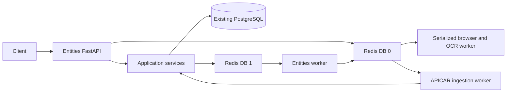

# Cars & Beyond backend

Backend for vehicle auction ingestion and enrichment, bidding, inventory, user management and analytics.

The application now lives in **entities/**. The former **parsers** FastAPI application, package and Dockerfile have been removed; its active integrations, jobs, API contracts, tests and reference fixtures are part of entities.

## Runtime architecture



One API/codebase, with separate worker processes for different workloads:

| Compose service | Application / queue | Responsibility |
| --- | --- | --- |
| `entities` | `main:app` | Existing business APIs and transferred parsing routes |
| `celery` | `core.celery_config.app`, `car_parsing_queue` | Existing vehicle background workflows |
| `celery_worker` | `core.integration_celery.app`, `celery`, solo | Periodic APICAR import/deletion |
| `scraping_worker` | `core.integration_celery.app`, `scraping`, solo | DealerCenter, browser-based fees and OCR |
| `celery_beat_entities` | Redis DB 1, America/Chicago | Existing entities schedules |
| `celery_beat` | Redis DB 0, UTC | Existing APICAR schedules |

The two Redis databases and legacy task names are retained so messages already queued before migration remain routable. The scraping worker processes one operation at a time and reuses its asyncio event loop and authentication state. Keep one active scraping worker while auth synchronization remains process-local.

## Code boundaries

```text
entities/
  api/v1/routers/       HTTP contracts and error mapping
  services/            Application scenarios and import planning
  domain/              Pure calculations and internal data/port definitions
  crud/                SQLAlchemy persistence operations
  integrations/
    apicar/            APICAR client and data conversion
    dealercenter/      Production/local scraper implementations
    fees/              Copart and IAAI extraction
    parsing.py         Local compatibility adapter for existing callers
    scraping_rpc.py    Dedicated scraping queue adapter
  tasks/               Celery entrypoints and legacy task aliases
  models/              Existing ORM/database mappings
  schemas/             Public request/response models
  tests/               Unit, HTTP, PostgreSQL and runtime checks
```

APICAR import calls the bulk application service directly. No internal HTTP calls to a parsers server remain. The temporary `ParsingClient` compatibility boundary retains HTTPX-style responses for legacy error handling; its legacy hostname is response metadata only.

Manual vehicle upsert uses `services/vehicle_upsert.py` to commit persistence before publishing enrichment through an injected queue adapter. Its parsing decision is a pure domain rule. Broker failure preserves the saved vehicle and the existing successful response with a null task id.

Single-VIN lookup uses the injected `VehicleDataSource` interface and `services/single_vehicle_ingestion.py`. The APICAR adapter returns validated snapshots; the router maps application errors to the existing HTTP responses. Legacy error text is retained in the adapter.

`services/vehicle_snapshot.py` owns the transaction for snapshot persistence. `crud/vehicle_snapshot.py` writes the vehicle, photos, conditions and sales history without committing. Its application result distinguishes a failed save from a successful save that needs no enrichment; existing endpoint response policies are retained.

Recommendation decisions for bulk imports, individual snapshots and manual upserts live in `domain/vehicle_recommendations.py`. They use immutable facts/state and retain each workflow's current fuel normalization, bid limit, manual override and reason formatting rules. `services/vehicle_recommendations.py` maps ORM/schema values to these domain inputs and applies the resulting state.

`tasks.task.update_car_bids` delegates to `services/vehicle_bids.py`, which owns the refresh transaction. `crud/vehicle_bids.py` selects candidates and locks matching rows with `SKIP LOCKED`; domain functions handle bid identities, recommendation changes and profit/ROI calculations. The injected current-bid source retains the existing parser request, retry policy and payload handling.

Bidding-hub removal delegates to `services/bidding_hub.py`. CRUD retains the blocking row lock and status flush; the service commits the soft-removal status and history together. The vehicle, relevance and existing inventory remain intact, including removal of a `WON` vehicle. Repeated DELETE still logs another history entry, and failures retain the existing 404/500 responses.

Bidding-hub history reads also delegate to this service. CRUD loads history with users and roles in descending creation order; the service builds the response without committing or rolling back the read transaction. Empty history retains its 404, and incomplete user data retains the existing 500 response.

The bidding-hub list uses the same service and its dedicated CRUD module for pagination and sorting. The caller owns the read session. Existing status filtering, latest-author user sorting, response mapping and 400/404/500 responses are preserved, including 404 for a page beyond the available results.

Vehicle filter options use `services/vehicle_filter_options.py` and `crud/vehicle_filter_options.py`. The service groups makes/models and builds ranges from database values; the public route retains its existing schema. Options use active vehicles, while damage descriptions still include all assessments. Zero range bounds retain the existing null response.

Vehicle like toggling uses `services/vehicle_likes.py` to commit the current user's association change and roll back unexpected failures. `crud/vehicle_likes.py` loads the vehicle and the user's likes and changes the relationship without committing. The existing route, authentication, `Liked`/`Unliked` responses and missing-car 404 are preserved.

Vehicle cost updates use `services/vehicle_costs.py` for commit/refresh and persistence-error rollback, with row locking and ORM changes in `crud/vehicle_costs.py`. Partial updates retain explicit nulls, zero and negative values. Suggested bids use the existing investment sum, and a failed refresh after commit still leaves the update persisted.

`tasks.task.update_fees` delegates Copart tariff replacement to `services/fee_import.py`. The source adapter preserves the existing scraping call; `domain/fee_import.py` converts ranges, percentages and fixed fees, and `crud/fee_import.py` replaces exact `copart` rows inside the service transaction. Conversion or commit failure rolls back the replacement. A valid empty table retains the previous behavior of clearing Copart tariffs.

IAAI upload uses an injected image source, its separate conversion policy in `domain/iaai_fees.py`, and the same service/CRUD boundaries for async persistence. The router retains multipart inputs, forwarded response/status and 502/500 error mapping. Its legacy JSON error response policy is preserved: upstream 400/500 JSON may still replace IAAI tariffs with default fees before that status is forwarded.

Manual `/fees` operations use `services/fees.py` for transaction handling and `crud/fees.py` for reads/writes. The router retains authentication, response schemas and missing-fee 404s; database integrity errors reach the existing global 409 handler. PUT still requires its existing nullable fields and updates only explicitly supplied values. Amount precision, range handling and post-commit refresh behavior are retained.

Scheduled filter dispatch delegates to `services/filter_kickoff_queue.py`. Its sync repository acquires the existing advisory transaction lock and selects due scheduled jobs with `SKIP LOCKED`; an injected publisher retains the kickoff task name, queue and kwargs. Publication still precedes commit, so a commit failure can leave an already published job scheduled for a later retry.

Creating an admin filter delegates to `services/vehicle_filters.py`. The service atomically writes the filter, activates matching vehicles and reserves the parsing slot; `crud/vehicle_filters.py` performs writes without committing. Existing selection rules are retained, including wildcard models and activation without a `WON` exclusion. The response refresh still follows commit, so a refresh failure can occur after all three changes are persisted.

Updating a filter uses the same service with its separate legacy policy: commit the filter first, then commit the relevance delta, then publish directly through `CeleryFilterUpdateKickoffPublisher`. The router retains the busy check and 404/409 responses. Update selection ignores falsy constraints; activation affects only newly matching irrelevant cars, while removal protects `WON`. Broker failure leaves both database phases committed. PATCH still sends a numeric filter id as `lock_token` and creates no new scheduled queue row.

Deleting a filter also delegates to `services/vehicle_filters.py`, committing matched-car changes and filter deletion together. DELETE retains exact make/model equality, including `NULL`, its existing range defaults and `WON` protection. Archived matches are deleted and active matches become irrelevant; the existing foreign key cascade removes the filter's queue row. Foreign key failures roll back the transaction and retain the existing 500 response; successful deletion returns an empty 204.

Admin ROI uses `domain/roi.py` for its formula and input rounding, `services/roi.py` for reads/creation, and `crud/roi.py` for persistence. The ORM validator uses the same profit-margin formula without changing its nullable/negative-value policy. Admin latest/list remain ordered by id, while enrichment still selects ROI by creation time. Existing HTTP quirks are retained: negative POST returns 400; negative or missing `/roi/calculate` input returns its previous 500. Calculation remains transient, and creation commits before response refresh.

Filter execution delegates to `services/filter_execution.py`, with selection and status writes in `crud/filter_execution.py`. The read session closes before enrichment messages are published through the registered task's existing `delay` routing. Completion and failure use fresh sessions; partial publication or completion commit failure records `FAILED` without retracting messages already sent. Task arguments, result dictionaries and selection rules are retained, including the unused `stream_chunk` argument.

Expired irrelevant vehicle cleanup uses `services/expired_vehicles.py` for transaction handling and `crud/expired_vehicles.py` for selection and ordered deletion of inventory, investments, history and other dependencies. It retains the `WON` exclusion, inclusive date cutoff and continuation to active vehicle processing after cleanup failure. The legacy deletion counter is assigned before commit and can remain nonzero after rollback.

The full expired-auction workflow delegates to `services/expired_vehicle_refresh.py`. Its source adapter retains the existing parser path and timeout; CRUD handles candidate selection and snapshot writes, while domain policies determine recommendation overrides and final relevance. Per-vehicle commits, rollback/continuation, BuyNow handling and historical counter timing remain intact. The existing ORM conflict when replacing loaded condition assessments is characterized by a rollback test and retained for a separate behavior fix. The source still uses `/api/v1/apicar/{vin}`, including its existing local 404 behavior.

Parser failures share `services/vehicle_enrichment.py`. CRUD retains the transaction-local two-second lock timeout and `FOR UPDATE NOWAIT`; the service records the reason, invalid VIN flag and business attempt in one transaction. Missing vehicles return `not_found`, successful recording returns `exception`, and every `OperationalError` still returns `locked_skip` after rollback. Reason formatting is shared with the successful enrichment path through `domain/vehicle_enrichment.py`.

`domain/enrichment_planning.py` prepares parser facts and market-refresh plans, calculates ROI projections and sums percentage/fixed fees without database or task dependencies. Market-source merging lives in `domain/market_price.py`; `crud/enrichment_pricing.py` selects the latest ROI and exact-auction inclusive fee ranges. The final locked write compares both market price and source composition before applying derived fields, preserving concurrent manual changes.

Successful enrichment passes an `EnrichmentCompletion` to `services/vehicle_enrichment.py`, which owns the final commit/rollback. CRUD acquires the existing `NOWAIT` lock with transaction-local lock/statement timeouts and applies facts, history, market fields and report metadata. Celery retains lock-conflict retry handling and the previous countdown/results; non-lock operational errors propagate. Report upload still precedes this transaction, so a later database failure may leave an uploaded report unreferenced.

`integrations/vehicle_enrichment.py` owns history/parser requests and S3 report serialization. The task injects its existing retry helper and storage factory, preserving raw parser query interpolation, headers, timeouts, report keys and URLs. Typed main-parser errors retain their database reason strings. History and storage failures remain best effort; parser JSON with a non-object top level still propagates as before. These external calls run between database sessions, before the final row lock.

`services/vehicle_enrichment_workflow.py` now orchestrates the complete enrichment scenario through source/storage protocols. Its initial CRUD read returns an `EnrichmentSnapshot` rather than a detached ORM entity. `parse_and_update_car` assembles dependencies and handles Celery retries only; a typed `EnrichmentLockConflict` identifies final-write conflicts so read or pricing errors do not acquire new retry behavior. Report-storage construction remains lazy and best effort.

`domain/enrichment_decisions.py` decides how a prepared result changes the locked vehicle's live state: history insertion, mileage checks, recommendation reasons, market-update eligibility, suggested bid and next attempt. The transaction service maps live ORM values to these inputs; CRUD applies the resulting decision without recalculating business rules. Suggested bid uses the new auction fee and current transportation/labor/maintenance/parts costs, including edits made during the parser call.

Database engines are created lazily through `db/factories.py`, using the shared `DatabaseConfig`. API and async jobs use `session_scope`: outstanding transactions are rolled back and sessions are closed, while application services retain ownership of commit. API shutdown and the integration worker's event-loop shutdown release their async pools. Sync workers own a separate lazy pool and discard inherited pools after fork without closing parent connections.

Pool defaults remain 50 connections plus 10 overflow per process, a 30-second acquisition timeout and 1800-second recycle. Configure `DB_POOL_SIZE`, `DB_MAX_OVERFLOW`, `DB_POOL_TIMEOUT` and `DB_POOL_RECYCLE` in the environment. SQL echo defaults to off (`DB_ECHO_SQL=false`); statement parameters are hidden. Alembic uses the shared URL builder and resolves revision paths relative to `alembic.ini`.

Browser/OCR libraries are loaded by their adapters in the scraping worker. Importing the API does not import Playwright, BeautifulSoup, Pillow or Tesseract.

## API compatibility

Existing entities paths and request/response schemas are unchanged. The former parser routes are now served by the same API:

- `GET /api/v1/apicar/get/{car_vin}`
- `GET /api/v1/apicar/update/{car_vin}`
- `GET /api/v1/parsers/scrape/dc`
- `POST /api/v1/parsers/scrape/current_bid`
- `GET /api/v1/parsers/scrape/fees`
- `POST /api/v1/parsers/scrape/iaai/fees`
- `POST /startup`

Compose maps host ports **8000 and 8001 to the same API port 8000**. External clients using the old host port can retain their paths. There is no separate Docker service/DNS name `parsers`; internal integrations use local services or queues.

OpenAPI snapshots verify the transferred operations, including parameter names and legacy spelling. The existing `/api/v1/apicar/{vin}` path remains absent; correcting callers that used that missing path is a separate behavior change.

## Environment and deployment

Use Python **3.12** for the verified development environment. Configuration is centralized in `entities/.env`; [entities/.env.example](entities/.env.example) documents the names without real credentials. Keep existing database settings and secrets when migrating.

Key integration settings:

| Variable | Purpose |
| --- | --- |
| `APICAR_KEY` | APICAR credential, formerly configured in parsers |
| `DC_USERNAME`, `DC_PASSWORD` | DealerCenter login |
| `DC_SMTP_USER`, `DC_SMTP_PASSWORD` | MFA inbox; falls back to existing SMTP credentials |
| `PARSING_ENVIRON` | `prod` by default; `dev` selects the former local scraper |
| `ENTITIES_BROKER_URL`, `ENTITIES_RESULT_BACKEND` | Default `redis://redis:6379/1` |
| `INTEGRATION_BROKER_URL`, `INTEGRATION_RESULT_BACKEND` | Default `redis://redis:6379/0` |
| `DEALERCENTER_CREDENTIALS_FILE` | Local scraper cache; scraping image uses its persistent volume |

The two Celery applications use explicit scoped settings; generic `CELERY_BROKER_URL` / `CELERY_RESULT_BACKEND` cannot override both applications in the same process.

Compose temporarily reads an optional existing `parsers/.env` for migration. It does not modify that file. Entities settings take precedence for the API and ingestion; legacy parser settings take precedence inside the scraping worker. Consolidate those credentials into entities configuration and set `PARSING_ENVIRON` to the former parser `ENVIRON` value before removing the optional file. Compose 2.24+ is needed for optional env files.

The single Dockerfile has two targets:

```sh
docker build -f entities/Dockerfile --target api -t entities-api .
docker build -f entities/Dockerfile --target scraping -t entities-scraping .
```

The default/API image installs main dependencies. The scraping image additionally installs the optional scraping group, Chromium/ChromeDriver, Playwright Chromium, Cairo and Tesseract. Builds install from the committed lockfile.

For cutover, quiesce the old beat processes and let in-flight jobs finish before stopping the old API/workers. Preserve Redis data and allow queued messages to drain through the retained task names. Each schedule must have one active beat. The replacement beats use separate files in the `celery_beat_state` volume; migrate the previous schedule databases to their corresponding paths before switching. Details and local verification limits are in the [consolidation record](docs/parsers-consolidation.md). No database schema migration is introduced by this consolidation.

## Development and tests

```sh
cd entities
poetry install --no-root --with scraping
poetry run pytest
poetry run pytest tests/unit/domain
poetry run pytest --run-postgres
```

The PostgreSQL profile creates a disposable local cluster and a separate database per test. It never accepts a production database URL. Native PostgreSQL binaries are required.

Runtime smoke tests use synthetic local data:

```sh
poetry run playwright install chromium
poetry run pytest tests/runtime --run-scraping-runtime
```

The scraping image provides ChromeDriver and Tesseract for all three runtime checks. CI builds both Docker targets and runs these checks inside the scraping image.

See the [testing guide](entities/tests/README.md) for fixture boundaries and options, the [refactoring record](docs/refactoring-plan.md) for preserved behavior and stage results, and the [pre-consolidation documentation](docs/architecture-before-consolidation.md) for the original detailed domain/API reference. That historical document's service layout and startup instructions have been superseded.
